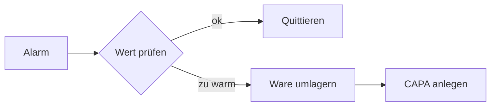

# {{title}}

> [!IMPORTANT]
> Gilt für alle Kühlräume mit Sensorüberwachung. Diese Anweisung ist {{doc_id}}, Fassung {{version}}.

## 1. Ablauf bei einer Abweichung

| Schritt | Verantwortlich | Frist |
| :------------------------------------- | :-------------------- | ---------------: |
| ✅ Alarm quittieren | Schichtleitung | sofort |
| ⚠ Ware in Ausweichkühlraum umlagern | Lager | 30 min |
| ☐ CAPA-Bericht anlegen | QS | 1 Tag |

## 2. Protokoll

* **Ereignis:** [@#ereignis ____________]
* **Datum:** [@#entdeckt_datum TT.MM.JJJJ] **Uhrzeit:** [@#entdeckt_uhrzeit HH:MM]
* **Ort:** [@#ort ______________________________] <!--* Zone › Gerät › Probe -->
* **Temperatur:** [@#temperatur ______] °C
* [@#umgelagert] Ware umgelagert
* [@#qs_informiert] QS informiert

**Maßnahmen:**

[@#massnahmen ______________________________________________________________________
______________________________________________________________________]
